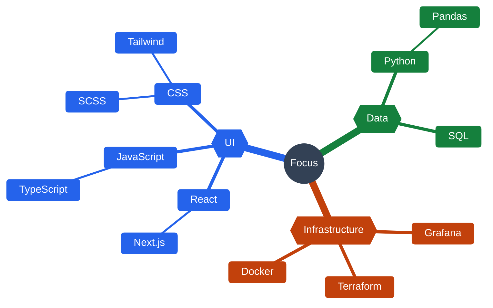

# [geoffreytan.dev](https://geoffreytan.dev/) &middot;  

> [!NOTE]
> Hi, I'm Geoffrey, a software engineer who builds fast, accessible web apps with TypeScript, React and Next.js.
>
> I also enjoy working with data (Python, Pandas, SQL, Grafana) and the infrastructure that ships it (Docker, Terraform).

| Languages                                                                      | Frameworks                                                                                | Infrastructure                                                                                         |
| ------------------------------------------------------------------------------ | ----------------------------------------------------------------------------------------- | ------------------------------------------------------------------------------------------------------ |
|  |  |  |

